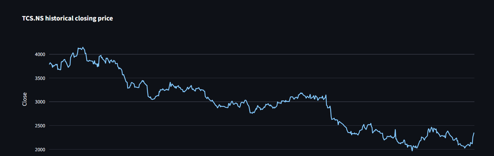
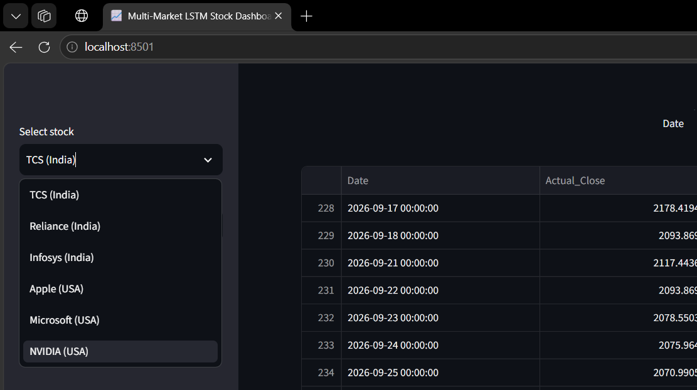
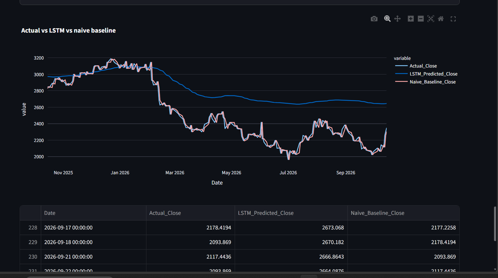
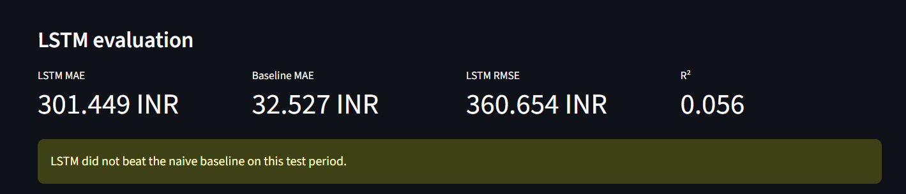
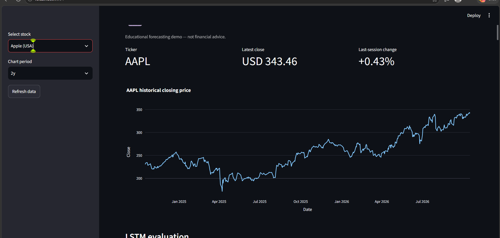

# Multi-Market Stock Analytics & Prediction

An educational stock market analytics and price prediction project using Python, Machine Learning, and LSTM neural networks. Explore historical stock prices and evaluate prediction performance for selected Indian and US stocks.

## Features

- Historical stock price analysis and visualization
- Exploratory Data Analysis (EDA)
- Stock price prediction using machine learning
- LSTM-based time-series forecasting
- Actual vs. predicted price comparison
- Model evaluation using MAE, RMSE, and R²
- Support for selected Indian and US stocks
- Interactive Streamlit dashboard

## Tech Stack

- **Language:** Python
- **Machine Learning:** Scikit-learn, TensorFlow/Keras
- **Data Collection:** yfinance
- **Data Analysis:** Pandas, NumPy
- **Dashboard:** Streamlit
- **Visualization:** Plotly, Matplotlib

## 📸 Project Screenshots

### 1. Historical Stock Price Chart
Displays historical stock price movements over time.



### 2. Supported Markets and Stocks
Overview of the stocks supported by the project.



### 3. Actual vs. LSTM Baseline
Compares actual stock prices with model predictions and the baseline.



### 4. Model Evaluation
Shows model performance evaluation metrics.



### 5. US Stock Dashboard — Apple (AAPL)
Interactive dashboard displaying Apple's historical prices and analytics.




## Project Structure

```text
Multi-Market-Stock-Analytics-Prediction/
├── app.py
├── app_lstm.py
├── download_data.py
├── eda.py
├── train_model.py
├── train_return_model.py
├── train_lstm.py
├── plot_predictions.py
├── plot_return_predictions.py
├── requirements-lstm.txt
├── README.md
├── README_LSTM.md
├── RUN_GUIDE.txt
├── data/
├── models/
├── outputs/
└── multi_market_lstm_github_assets/
    └── screenshots/
```

## Installation

Clone the repository:

```bash
git clone https://github.com/tulsidounekarr/Multi-Market-Stock-Analytics-Prediction.git
cd Multi-Market-Stock-Analytics-Prediction
```

Create and activate a virtual environment on Windows:

```powershell
python -m venv .venv
.\.venv\Scripts\Activate.ps1
```

Install dependencies:

```bash
python -m pip install -r requirements-lstm.txt
```

## Run the LSTM Model

Train the model for TCS:

```bash
python train_lstm.py --ticker TCS.NS
```

Train the model for Apple:

```bash
python train_lstm.py --ticker AAPL
```

To train on all configured stocks:

```bash
python train_lstm.py --all
```

## Launch the Dashboard

```bash
python -m streamlit run app_lstm.py
```

To launch the existing dashboard instead:

```bash
python -m streamlit run app.py
```

## Model Evaluation

Model performance can be evaluated using:

- **MAE:** Mean Absolute Error
- **RMSE:** Root Mean Squared Error
- **R²:** Coefficient of Determination

Compare the LSTM model against a simple baseline. Actual performance varies by stock and test period; the model is not guaranteed to outperform the baseline.

## Screenshots

Project screenshots are available in the `multi_market_lstm_github_assets/screenshots/` folder.

## Disclaimer

This project is intended for educational purposes only. Stock predictions are estimates, not financial advice. Financial markets are unpredictable, and this project should not be used as the sole basis for investment decisions.

## Author

**Tulsi Dounekar**

GitHub: [@tulsidounekarr](https://github.com/tulsidounekarr)
